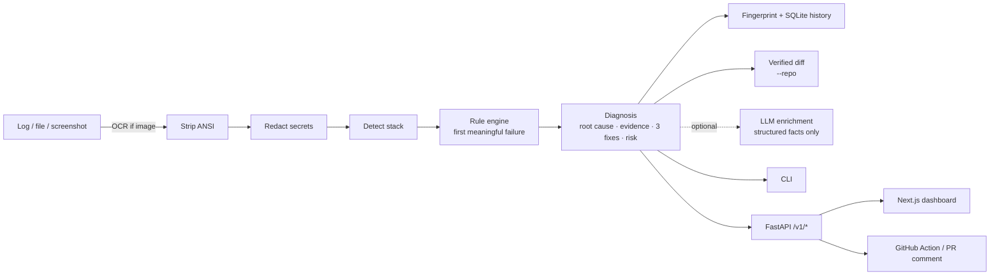

# 🔍 ErrorLens
**Paste a failure. Get the real fix.** A privacy-first debugging assistant for build logs, terminal output,
tracebacks and screenshots. It finds the *first meaningful failure* (not the last scary line), extracts evidence,
redacts secrets locally, fingerprints the error, rates the fix risk and generates a share-safe report.

> Deterministic parsing extracts the facts. The (optional) LLM only explains them.

## Features
- **Root-cause ranking** — cascade lines (`ELIFECYCLE`, `exited with 1`, `Deployment failed`) are separated from the real error
- **Rule packs** — Next.js/Vercel, Node/npm, Python tracebacks, Docker, GitHub Actions (easy to extend)
- **Secret redaction** — API keys, JWTs, Bearer tokens, URL credentials, PEM keys, `*_SECRET=…`; runs before parsing, storage and AI
- **Fingerprints** — same bug, different run → same `EL-XXXXXXXX`; local SQLite history with recurrence + known resolutions
- **Verified diffs** — point at your repo (`--repo`) and import typos get a real unified diff
- **Risk engine** — flags `--force`, `--legacy-peer-deps`, `ignoreBuildErrors`, secrets in `NEXT_PUBLIC_*`, lockfile deletion
- **Screenshots** — Tesseract OCR, shown as editable text
- **Optional AI** — EN + Hinglish explanation from redacted, structured facts only (never the raw log)
- **Surfaces** — CLI, FastAPI, Next.js dashboard, GitHub Action

## Architecture


## Quick start
```bash
pip install -e ".[dev]"             # add tesseract-ocr (apt/brew) for screenshots
errorlens analyze samples/vercel_module_not_found.log
errorlens analyze samples/vercel_module_not_found.log --repo demo/broken-nextjs   # verified diff
errorlens analyze screenshot.png --show-ocr
errorlens report build.log --format github -o comment.md
errorlens history search "env"
pytest
```
**Dashboard:** `errorlens serve`, then `cd web && cp .env.example .env.local && npm install && npm run dev`.
**AI (optional):** `export ANTHROPIC_API_KEY=…` then `errorlens analyze build.log --ai`.
**GitHub Action:** see `examples/errorlens-workflow.yml`. **Deploy:** `docs/DEPLOY.md`. **Add a rule:** `docs/ADDING_RULES.md`.

## Privacy
Redaction happens first, always. History stores fingerprints and summaries only. AI mode sends only redacted structured
facts. `local_only` mode makes no network calls at all.

## Roadmap
Vercel webhook integration · more rule packs (Prisma, Django, Pydantic) · "did this fix work?" feedback ·
team-private knowledge base · GitHub App.
